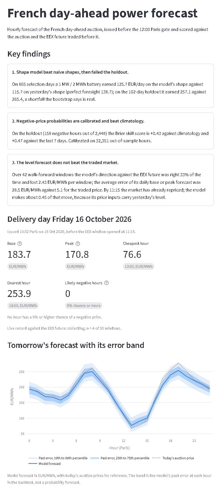

# thermo-fr

An hourly forecast of the French day-ahead power price, issued before the 12:00 Paris auction gate, with a recalibrated probability of negative prices and a model of the day's shape valued with a battery. Each forecast is scored against the auction result and against the EEX French day-ahead future traded 11:15 to 12:00 Paris.

**Live app:** [thermo-fr-cy6smxhzz5tj77jmvyqfng.streamlit.app](https://thermo-fr-cy6smxhzz5tj77jmvyqfng.streamlit.app/), updated each weekday morning before the market window and each afternoon after the auction.



## Findings

**1. The shape model added battery value on the selection window, but the holdout did not confirm it.** On the selection window (865 days, 2024-02-17 to 2026-06-30) a 1 MW / 2 MWh battery earned 125.7 EUR/day trading the model's shape, against 115.7 EUR/day on yesterday's shape and 138.7 EUR/day with perfect foresight; shape MAE was 11.29 against 15.89 EUR/MWh. On the frozen holdout (102 days, 2026-07-01 to 2026-10-10) it earned 257.1 EUR/day against 265.4 for yesterday's shape and 266.5 for the last day of the same type; shape MAE was 22.37 against 23.10 and 21.96 EUR/MWh. The holdout shortfall against yesterday's shape is 8.3 EUR/day (block bootstrap 95% interval -20.1 to -2.2). The model's holdout shape error (22.37) was below yesterday's (23.10) but above the last similar day's (21.96), and it did not carry over to the battery, whose value depends on the cheapest and most expensive hours and the day's spread, where yesterday's shape did better (spread error 30.6 against 25.4 EUR/MWh). Holdout battery values are about twice the selection values because prices were higher: the auction averaged 123.4 EUR/MWh on the holdout against 59.4 on the selection window.

**2. Negative-price probabilities have skill.** On the holdout (2,448 hours, 158 of them negative) the recalibrated probability scores a Brier skill of +0.43 against climatology and +0.47 against the last 7 days. It is close to calibrated below 40%, where 2,345 of the 2,448 hours sit (gaps of at most 3 percentage points), and under-confident above 40%: in those 103 hours prices turned negative more often than forecast (in the largest bin, 29 hours, 55% forecast and 83% observed). The recalibration is isotonic and fitted walk-forward on out-of-sample predictions only; the live version rests on 32,351 out-of-sample hours.

**3. The level forecast does not beat the traded market.** Over 42 walk-forward windows (38 base, 4 peak; delivery days 2026-08-29 to 2026-10-10), going long or short the EEX future at its 11:15 to 12:00 Paris VWAP on the model's signal was right 33% of the time and lost 2.43 EUR/MWh per window. Against the auction result the model's daily base or peak average was 28.5 EUR/MWh out, the traded price 5.1. By 11:15 the market has already repriced away from the previous day's auction; the model makes about 0.45 of that move, because its price inputs carry yesterday's level, and its long or short call matches simple persistence in 29 of 42 windows. The hit rate is borderline: binomial p = 0.04 over 42 windows (0.14 for the 38 base windows alone); the calls were wrong more often than right, and 38 of the 42 windows are base contracts, so this is mostly a base record. The loss is clearer, with a day-block bootstrap 95% interval of -4.0 to -0.7 EUR/MWh per window. Aggregates: [published/market_walkforward.json](published/market_walkforward.json).

**Why the backtest error (15.7) is lower than the record's (28.5).** The backtest's 15.7 EUR/MWh is an hourly error over 2024-02-17 to 2026-06-30, 26% of the average price of 59.4 EUR/MWh. On the record's days, 2026-08-29 to 2026-10-10, the hourly error was 32.9 EUR/MWh, 24% of the average price of 139.0, and the daily price moved 27.9 EUR/MWh on average against 16.9. The record's 28.5 scores the daily base or peak average rather than single hours. A look-ahead check (blanking every input not yet published at the gate and rebuilding the features) found no leakage.

A live record against the market builds one window per weekday; the app shows its aggregates once 30 windows have settled.

## How it works

- **Information gate.** The auction closes at 12:00 Paris on the day before delivery. Every input is dated by when it is published, and a test fails if any input for delivery day D is stamped after 12:00 on D-1. The forecast used for scoring is issued between 10:05 and 11:00 Paris, before the EEX window opens at 11:15.
- **Inputs.** ENTSO-E day-ahead load forecast (due 10:00 on D-1); French prices of D-1, D-2, D-7 and the last day of the same type; D-1 prices of DE-LU, BE, NL, ES, IT-North and CH; lagged actual nuclear output; Open-Meteo forecasts issued two days ahead (temperature, 100 m wind at 17 points, radiation at 21 points), turned into wind and solar generation proxies in MW; load minus wind, solar and nuclear; the calendar (holidays, bridge days, day type). ENTSO-E's own wind and solar forecasts are not used because they may arrive after the gate. There is no gas or carbon input: the price lags stand in for fuel costs.
- **Models.** LightGBM for the hourly level and a LightGBM classifier for negative prices with an isotonic recalibration, both refitted monthly on history since 2021. The shape model (gradient boosting with each hour minus the day's mean as target) exists in the backtest only; the live battery record uses the shape of the level forecast.
- **Protocol.** Each change is tested under a rule written before the run. Variants are chosen on a selection window (2024-02-17 to 2026-06-30, monthly walk-forward), and the chosen one is scored once on a frozen holdout (2026-07-01 to 2026-10-10). Every result, accepted or rejected, is in [docs/experiments.md](docs/experiments.md).
- **Daily schedule.** A GitHub Actions workflow ([forecast.yml](.github/workflows/forecast.yml)) runs each step from a clean store and commits only `published/`. The author's laptop dispatches it: the forecast at 10:05 and 10:30 Paris on weekdays, scoring at 14:20 London daily, the model refit on the first weekday of each month. Backup crons cover scoring (13:15 UTC) and the refit (02:00 UTC); the morning forecast has no cron because GitHub ran scheduled jobs hours late. A forecast issued after 11:00 Paris is labelled not tradeable and never replaces the pre-market one.

Method and backtests: [docs/forecast.md](docs/forecast.md). Data, terms and glossary: [docs/data.md](docs/data.md). Commands, schedules and code layout: [docs/operations.md](docs/operations.md). Publishing and deployment: [docs/public_dashboard.md](docs/public_dashboard.md). The temperature study the project started from: [docs/thermosensitivity.md](docs/thermosensitivity.md).

## Run it

```bash
python -m venv .venv
source .venv/bin/activate                  # Windows: .venv\Scripts\activate
pip install -e ".[dev,forecast,dashboard]"
pytest                                     # offline
streamlit run streamlit_app.py             # the public app, reading published/ (no key needed)

export ENTSOE_API_KEY="your-token"         # free, from transparency.entsoe.eu
thermo-fr forecast-fetch                   # inputs from 2021 to the last complete month
thermo-fr forecast-backtest                # monthly walk-forward backtest, report in reports/forecast/
thermo-fr morning-run                      # tomorrow's inputs and forecast, into a local SQLite store
thermo-fr settle                           # auction results, then score the stored forecasts
```

The full command reference is in [docs/operations.md](docs/operations.md).

## Limitations

- The live record against the market is still small; the 42-window record above is a walk-forward reissue, not live trading.
- The EEX history is too short to select models on, so variants are chosen on their own backtest error.
- Attempts to close the gap to the market have not passed the holdout. The latest (October 2026: inputs describing the expected change from the previous day, and a target relative to yesterday's average) removed the systematic lag on the selection window but raised the holdout error from 25.81 to 26.19 EUR/MWh, so the model is unchanged ([docs/experiments.md](docs/experiments.md)).
- Without a gas or carbon input the model lags regime changes, and it is weakest in the top 5% price hours (cold, calm winter evenings) and on low-price weekend and holiday middays.
- The shaded band on the forecast chart is the model's past error at each hour, not a probability forecast. Price quantiles and a spike probability are computed daily but not shown: the quantile band under-covered on the holdout (73.8% for a nominal 80%) and the spike definition did not hold up.
- ENTSO-E serves only the latest version of the load forecast and of outage notices, so possible revisions after 10:00 cannot be excluded and planned nuclear availability is not yet an input.

## Data sources

- **ENTSO-E Transparency Platform** (transparency.entsoe.eu): day-ahead prices for France and its neighbours, the load forecast and actual generation. Used under the platform's terms, with the platform cited as the source; no endorsement by ENTSO-E is implied.
- **Open-Meteo** (open-meteo.com): weather forecasts as issued, CC BY 4.0.
- **RTE eCO2mix via ODRE** (opendata.reseaux-energies.fr): load history for the temperature study, Licence Ouverte v2.0 (Etalab).
- **EEX**: benchmark only. French day-ahead base and peak futures, trades between 11:15 and 12:00 Paris on the day before delivery, from EEX's public website data (15-minute delay). Statistics are derived by the author; no EEX data are redistributed, and only pooled statistics over at least 30 windows are shown. This project is not affiliated with or endorsed by EEX AG.

Details and the optional Energy-Charts source: [docs/data.md](docs/data.md). Forecasts and derived figures are the author's own. Research, not trading advice.

## Licence

Code under the MIT licence (see [LICENSE](LICENSE)). The data keep their own licences, listed above.

Built by Gerardo Rosales ([github.com/gerardorosch02](https://github.com/gerardorosch02)).
