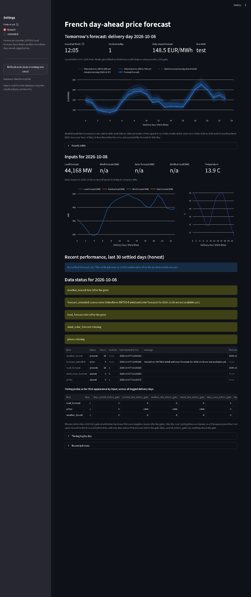

# Operations: commands, schedules and code layout

Moved from the README on 2026-10-15. How the public dataset is published and deployed is in [public_dashboard.md](public_dashboard.md).

## Forecast commands

```bash
pip install -e ".[dev,forecast]"                  # adds LightGBM and scikit-learn
export ENTSOE_API_KEY="your-token"
thermo-fr forecast-fetch                           # inputs 2021-01-01 to the last complete month, into data/forecast/
thermo-fr forecast-backtest                        # walk-forward 2024 and 2025, report in reports/forecast/
thermo-fr forecast --date 2026-10-06               # one day's curve and chart, as of 12:00 the day before
thermo-fr timing-probe                             # log which ENTSO-E items already exist for tomorrow
thermo-fr market add --date 2026-10-10 --product base --window 11:15-12:00 --open 100.00 --high 102.00 --low 99.00 --close 101.00 --vwap 100.50 --source "EEX via trader"   # illustrative prices
thermo-fr market paste --date 2026-10-10 --text "FR DA Base EEX Trades 11:15-12:00 O: 100.00 H: 102.00 L: 99.00 C: 101.00 VWAP: 100.50"
thermo-fr market fetch                             # collect tomorrow's window with the local collector module (laptop scheduler only)
thermo-fr market fetch --backfill 40               # one-off: the available history, one request every 10 seconds
thermo-fr market snapshot                          # 10:20 London: the latest EEX base trade before the 11:15 Paris window, for the local brief only
thermo-fr market evaluate                          # every recorded traded price against the forecast that was live before its window
```

## Collecting the EEX traded prices

Three ways in. `market fetch` collects the window itself: it runs a collector module that lives in `local/`, a git-ignored folder outside the package, because the module depends on the undocumented structure of EEX's public Market Data Hub page and on a request header that page expects, and EEX's notice says the data shown there is for information purposes. The public repository therefore carries only the contract the module must meet (`run_fetcher` in `forecast/market.py`: a `fetch(delivery_dates, window, raw_dir, spacing_s, log)` function returning one outcome per delivery day and product) and never the endpoint, the header or the contract codes. The module rebuilds the 11:15 to 12:00 Paris open, high, low, close and volume-weighted average from the trade-by-trade tape, with the trade count and the volume of the window, and marks the row "exact, from EEX tape"; it sends a plain user agent naming the project and a contact address, at most a handful of requests a day spaced ten seconds apart, no proxies and no rotation, and keeps the raw responses under `data/market/raw/` (git-ignored). It runs from the laptop's Task Scheduler only (weekdays at 12:20 Paris with one retry at 12:35, after the 15 minute display delay has passed the end of the window; on a Friday it also collects the Saturday, Sunday and Monday deliveries), never from GitHub Actions. A refusal, a changed page or a missing tape is logged to `data/market/fetch_log.csv`, shown in the dashboard's data status panel, and the day is skipped: nothing is guessed. `market snapshot` runs the same module once more, on weekdays at 10:20 London (11:20 Paris, before the window opens): it reads the base tape so far, which with the display delay reaches about 11:05 Paris, and stores the latest trade before 11:15 Paris with its time in `data/market/eex_fr_da_early.csv` (git-ignored, one request per delivery day, raw response kept apart from the window fetch's cache). It feeds the local brief's early-trade line and nothing else; it is never published. `market paste` is the fallback for such a day: it parses the free text a trader sends (product, window, O, H, L, C, VWAP; decimal commas accepted; the delivery date from `--date` or an ISO date in the text) and refuses anything incomplete. `market add` takes the numbers as flags. `market evaluate` scores each day with the latest honest forecast issued before the window opened, so a day whose only forecast came later is skipped, not scored with hindsight. It reports per day and in total: forecast, entry (the window VWAP, with the close as an alternative), auction result, direction, P&L per MWh, model error and market error against the auction, hit rate, cumulative P&L, how often the model's error was below the market's, and a few no-trade bands (trade only when the forecast is more than X from the entry), labelled in sample.

## Scheduled jobs and dashboard

Two jobs keep a local SQLite database (`data/forecast.db`) up to date, and a Streamlit dashboard reads it. The jobs are the only code that calls the APIs.

```bash
pip install -e ".[dev,forecast,dashboard]"       # adds streamlit and plotly
thermo-fr morning-run                             # tomorrow's inputs, timing log, both forecasts (new version each run); --refit fits live
thermo-fr settle                                  # actual prices, then every unscored forecast version is scored
thermo-fr dashboard                               # http://localhost:8501
```

`morning-run` fetches the ENTSO-E day-ahead load forecast, wind and solar forecasts and prices around the next delivery day, and the Open-Meteo weather forecasts issued two days ahead. For each input it records whether it is present for the delivery day, its hour count, revision number and a hash of its values, so the timing log (table `timing_log`) shows when each input first appeared relative to the 12:00 Paris gate and whether it changed between runs. It then stores the hourly inputs and a forecast for the honest feature set, predicted with the stored model `published/model/honest_v2.txt` (the same file the GitHub Actions workflow predicts with, so a local run and the workflow give the same curve for the same inputs; when one of its inputs is missing for the day the run predicts with the fallback `published/model/honest.txt` and records the fallback in the data status; `--refit` fits the model live on the inputs history instead, and a missing model file is recorded and falls back to a live fit), and, when the wind and solar forecasts exist, for the extended set, which has no stored model and is always fitted live. Every forecast is a new version stamped with its issue time; nothing is overwritten. A source that is down is logged in `data_status` and the run finishes as `partial` or `failed` instead of crashing. `settle` fetches the actual prices for today, tomorrow and every forecast day, stores them, and scores each version against them (the auction result); the same-hour-previous-day figure is still computed in the store for the backtests but is no longer published or shown. Both commands log to `logs/<command>_<date>.log`.

Windows Task Scheduler entries (the jobs run as the current user and read `ENTSOE_API_KEY` from the user environment, so set it with `setx ENTSOE_API_KEY ...` once):

```powershell
powershell -ExecutionPolicy Bypass -File scripts\schedule_tasks.ps1 -Install   # morning-run weekdays 07:00, 08:00, 09:15, 09:45, 10:30, 11:30; settle daily 14:00; market publish daily 14:30 (pushes published/market.json only); market fetch weekdays 11:20 and 11:35; market snapshot weekdays 10:20; outage snapshot weekdays 09:00 and weekends 10:00; fuel snapshot daily 22:15 (private collector, only if local\fuel_fetch.py exists); shadow-run weekdays 09:30 and 10:00 and shadow-settle daily 14:10 (laptop-only S2 shadow, see below) (local time, London intended; 09:15 and 09:45 London are pre-market runs at 10:15 and 10:45 Paris, 11:20 and 11:35 London are 12:20 and 12:35 Paris)
powershell -ExecutionPolicy Bypass -File scripts\schedule_tasks.ps1 -Show
powershell -ExecutionPolicy Bypass -File scripts\schedule_tasks.ps1 -Remove
```

All five tasks have "run task as soon as possible after a scheduled start is missed" and "wake the computer to run this task" turned on. Waking from sleep or hibernation also needs Windows to allow wake timers: Power Options, Sleep, Allow wake timers set to Enable for both plugged in and on battery (`powercfg /setacvalueindex SCHEME_CURRENT SUB_SLEEP RTCWAKE 1`, the same with `/setdcvalueindex`, then `powercfg /setactive SCHEME_CURRENT`). A machine that is shut down cannot be woken by a task.

The dashboard opens on the morning brief (branch desk-brief, 2026-10-13): one screen for the next delivery day written for a trader. Model forecast as base, peak (08:00 to 20:00) and off-peak from the pre-market forecast with its issue time; the hours whose calibrated probability of a negative price is 5% or more; a "what changed" table of tomorrow's fundamentals against the previous delivery day (the French D-1 base first, since the spreads are measured against it, then load forecast, temperature, wind and solar proxies, the latest nuclear output and residual load), each with value and change, with the D-1 base prices of DE, BE, ES, IT-North and CH (change in brackets) and their French spreads as a two-row block under it; a waterfall from yesterday's base model forecast to today's split into feature groups (recent French prices, labelled "model following the market" because the price lags carry the last traded level forward; neighbour prices; wind; solar; load and temperature; nuclear; calendar) using LightGBM's own per-feature contributions (`pred_contrib=True`, stored with every version as its drivers), with a one-line summary built from the two largest groups that says plainly when the French lags are the largest; the live record against EEX (the window count always, the hit rate, P&L and model against market error once 20 windows exist); and, on the local dashboard only, the gap between the model forecast and the latest EEX base trade before the window (from the 10:20 London snapshot, with the trade time), labelled with the model's live hit rate, or, when only the window close exists, that close labelled as coming after the forecast was issued and not framed as a gap to trade. The second page, Forecast and record, shows tomorrow's pre-market forecast (the last version issued before the EEX market window opens at 11:15 Paris on the day before; versions issued later are listed underneath as "issued after the market window, not tradeable") with today's actual prices and a shaded band built from the backtest's error distribution at each hour (historical error, not a probability forecast); tomorrow's forecast load, wind, solar, residual load and temperature with the change against today's inputs; the last 30 settled days against the auction result with rolling MAE (the model's own error; the EEX traded price is the only benchmark); a "Versus the market" panel with the daily table and cumulative P&L of the forecast against the recorded EEX traded prices; the data status for tomorrow (arrival time of each input, anything missing or late), the market data collection log with any day the collector skipped or was refused, and the timing-probe summary across all logged days. A sidebar toggle switches between the honest and extended feature sets, with a note that the extended set may use information published after the gate until the timing log shows otherwise. Database reads are cached; the "Refresh now" button runs `morning-run` once.



## Live shadow of S2 (laptop only)

The model sprint (pre-registration `sprint_prereg.md`, result and the shadow's set-up and deviations in [experiments.md](experiments.md)) sent S2, honest_v2 combined with LEAR under online inverse-MAE weights, to a 40-day live shadow next to the published honest_v2. The shadow runs on the laptop only and writes only to the local store (tables `shadow_versions`, `shadow_values`, `shadow_errors`, `shadow_scores`, `shadow_day_models`, `shadow_lost_events`, `shadow_result`) and to `data/shadow/` (git-ignored). Nothing is written to `published/`, committed, pushed or dispatched to GitHub Actions, and the public site is unchanged.

```bash
thermo-fr shadow-init                 # once, before the first live day: the weight state from the 2026-09-01 to 10-13 walk-forward (never shown)
thermo-fr morning-run --save-shadow-window   # the scheduled morning runs: also save the fetched window and the model file's sha256 under data/shadow/fresh/
thermo-fr shadow-run                  # S2, S1 and LEAR next to the latest pre-market honest_v2 version for tomorrow
thermo-fr shadow-settle               # score the shadow versions, report counted, fallback and lost days; the statistics at day 40 only
```

`morning-run --save-shadow-window` is the only change to the production path: after fetching, it saves the run's fetched inputs window (D-10 to D+1) as a CSV under `data/shadow/fresh/`, and after predicting, the sha256 of the model file each forecast was made with next to it; the forecast it stores is unchanged. The store keeps only the delivery day's 24 hours of inputs, not the lags and history LEAR needs, so no shadow day can be reissued: the shadow starts live, and the first counted delivery day is Tuesday 20 October 2026 (issued Monday 19 October).

`shadow-run` takes the latest honest_v2 version for tomorrow whose morning run started between 10:05 and 11:00 Paris and has no shadow version yet, builds LEAR's history from `data/forecast/inputs.csv` plus the saved windows (later windows win), blanks every value published after 10:05 Paris on D-1 by the timing rules, fits LEAR, and stores S2, S1 (equal average, diagnostic) and LEAR with the run's wall-clock issue time. The LEAR weight is stored but never logged or printed before day 40. A version issued at or after 11:15 Paris is kept but does not count. When LEAR cannot be issued, S2 and S1 are stored as copies of honest_v2 marked as a fallback, which counts against the 10% limit.

The model file follows the published monthly refit. At the first shadow run for a delivery day, the shadow reads `published/model/honest_v2.txt` and `honest_v2.json` from the origin/main ref that the 14:30 market publish fetches into `.publish-worktree` (before that worktree exists, the same ref through the repository), with read-only git commands only (`rev-parse`, `show`, `log`; never fetch, pull, checkout, commit or push), and stores them as `data/shadow/models/<sha256>.txt`. The day records the sha256, the ref commit and its time and age, the commit that last changed the file, `fitted_at_utc`, `train_from` and `train_to`, LEAR's windows and recalibration date, and whether the file changed against the previous day; the second run of the day reuses the file. When the ref cannot be read, the last stored file is used and the day says so. The comparator is the morning run's own honest_v2 version, predicted with the model file of the laptop's checkout: a day whose comparator names a different sha256 is lost, not counted. So after each monthly refit (the next on Monday 2 November) the laptop's checkout must be updated with `git pull` on main before the next morning's 09:15 London run; until then every day is lost as a file mismatch.

`shadow-settle` prints, every afternoon, "n of 40 settled shadow days (f fallback; l lost (reasons) of the expected days to ...)", where the expected days are the Tuesday-to-Saturday delivery days from 20 October and a lost day is one that is not counted (no pre-market morning run, a file mismatch, a version after 11:15, no shadow run). At day 40 it computes once the mean daily MAE difference (S2 minus honest_v2), its 90% moving-block bootstrap interval, the fallback rate, the adoption verdict, the lost days with their reasons and the counted days on each model file (counts only), and stores them in `shadow_result`. All four commands log to `logs/<command>_<date>.log`.

One-time steps on the laptop (Windows PowerShell, in the repository folder), after the model-sprint branch has been pushed and merged into main on GitHub:

```powershell
git checkout main
git pull
python -m pip install -e ".[dev,forecast,dashboard]"
python -m thermo_fr shadow-init
powershell -ExecutionPolicy Bypass -File scripts\schedule_tasks.ps1 -Install   # re-registers every task: morning-run now saves the shadow window; adds shadow-run weekdays 09:30 and 10:00 and shadow-settle daily 14:10 (local time, London intended: 10:30 and 11:00 Paris, before the 11:15 window)
powershell -ExecutionPolicy Bypass -File scripts\schedule_tasks.ps1 -Show
git diff --stat origin/main -- published/model/honest_v2.txt   # prints nothing: the checkout's model file is the published one
```

`shadow-init` reads `data/forecast/inputs.csv` and the actual prices in the store and took about 25 minutes in the build container (not measured on the laptop); run it once, before the first live morning, Monday 19 October 2026. `-Show` should list "thermo-fr shadow-run" and "thermo-fr shadow-settle" as Ready. To stop the shadow, remove its two tasks (`Unregister-ScheduledTask -TaskName "thermo-fr shadow-run" -Confirm:$false`, the same for "thermo-fr shadow-settle"); the saved windows and model files are small and can stay.

## Public dashboard and automated updates

`streamlit_app.py` is a public version of the dashboard that reads only `published/` and runs on Streamlit Community Cloud. A GitHub Actions workflow keeps that folder current without any local machine: on weekday mornings it fetches the days around the next delivery day and publishes the forecast made with the stored model, every afternoon it fetches the auction results and scores the stored forecasts, and on the first weekday of each month it fetches the full history, refits the honest model and commits the model file with its metadata. The morning runs are timed for the market and triggered from the laptop: GitHub's schedule trigger ran hours late or not at all in October 2026, so a scheduled task runs `thermo-fr dispatch` (a `gh workflow run` with the stored login, no secret on the command line) at 09:05 and 09:30 London, which is 10:05 and 10:30 Paris all year, and records each dispatch in the local store. The weekday morning crons that backed this up were removed on 2026-10-13: on 12 October GitHub delivered them 9 to 12 hours late, and a run that arrives after the window cannot back up a pre-market forecast, it only adds after-window versions and failure risk. The settle is dispatched the same way at 14:20 London, so the public record is scored the same afternoon; its 13:15 UTC cron stays as a backup, and a second settle of the same day changes nothing: the same prices are stored again, nothing new is scored, and the workflow commits nothing when only the stamps in `status.json` changed (`thermo-fr publish-unchanged`). The monthly refit is dispatched the same way, on the first weekday of the month at 07:00 London, with the 02:00 UTC cron as a backup; the refit is idempotent (`thermo-fr refit-model --once-per-month`): when the model metadata already shows a refit in the current month, the second trigger exits as already refitted without committing, the metadata records which trigger (dispatch or cron) produced the fit, and the local dashboard's data status shows the last refit's date and trigger, red when the month has none by the 5th. `thermo-fr schedule-step` decides a dispatched morning-run by the Paris clock: one that starts between 10:05 and 11:00 Paris, after the load forecast deadline and before the 11:15 market window, is the pre-market run; one that starts later runs for information only and its version is labelled "issued after the market window, not tradeable", never replacing a pre-market version. Issue times are the run's wall clock, never a scheduled time. The public app's headline for each day is the pre-market version. The token lives in a repository secret and is never printed or committed. `published/` holds the last 90 days of forecasts (with issue times), actual prices, daily errors against the auction result, tomorrow's latest forecast, the backtest error band, the negative-price probabilities, the drivers of each version (`drivers.csv`: per model feature, the daily mean of the feature and of its LightGBM contribution, grouped, from which the public morning brief builds its fundamentals table and waterfall; public inputs only, nothing from EEX) and the model; no inputs history is kept in the repository. The public app's first page is the same morning brief as the local one, minus the early-trade line; its arithmetic is a copy of `forecast/brief.py` kept equal by a test. In `probabilistic.csv` and `tomorrow_probabilistic.csv` the column `p_negative` is the calibrated probability of a negative price, the one the public app shows; `p_negative_raw` is the classifier's uncalibrated output, published only so that the monthly refit on GitHub Actions can extend the calibration's out-of-sample pairs, and shown nowhere; `calibrated` is 1 when the calibration was applied to that version. Of the market comparison the public app shows aggregates only (days scored, hit rate, mean P&L per MWh, model against market error), and only once 20 days are scored (`MIN_PUBLIC_DAYS` in `forecast/market.py`), because with a handful of days the mean P&L and the public auction result would let a reader back out the traded prices; until then it says "Versus the market: collecting data, n of 20 days". The prices themselves stay local. The aggregates score the version the public saw: before scoring, the laptop fetches main and archives the versions in `published/forecasts.csv` as committed there, and a delivery day counts only if one of those versions was issued before the market window; a day for which the laptop holds an earlier local version but the public site does not is not counted (the local dashboard still scores the local versions, labelled as such). The aggregates reach the public dataset through one file: after its 14:00 settle the laptop writes `published/market.json` and pushes that file alone (`thermo-fr market publish`, scheduled at 14:30 London; pull with rebase first, one retry, never a force push). It does so in a dedicated worktree of origin/main (`.publish-worktree`, git-ignored, created on first use and reset to the fetched branch each time), never in the main working tree, so a feature branch or uncommitted work checked out on the laptop can neither block the publish nor be pushed by it; and the workflow's publish step copies it into `status.json` unchanged and never writes it, so the two machines never edit the same file. The file holds aggregates only: a test fails if a per-day market value (a forecast, an entry price, an auction result or a day's P&L) appears in it, and below 20 scored days it carries the count, the definition sentence and the stamps alone. The laptop's commit is signed with the identity of the repository's local git config, which the publish reads itself and pins on the commit so no global setting can put another address on it; the commit skips the local pre-commit hook (one generated file, not code), and its outcome, including a failed push, is recorded as a run in the local store and shown on the local dashboard's market panel.

```bash
thermo-fr publish                   # export the public dataset from the local database
thermo-fr import-published          # the reverse, used by the workflow to restore its state
thermo-fr refit-model               # fetch the full history and save published/model/honest_v2.txt and honest.txt, their metadata, wind_proxy.json and solar_proxy.json
thermo-fr morning-run --feature-sets honest_v2   # what the workflow runs: predict with the stored default model, honest.txt as fallback (the default locally too)
streamlit run streamlit_app.py      # the public app, locally
```

Setup steps (secret, Streamlit deployment, live link) and the data-terms notes are in [docs/public_dashboard.md](public_dashboard.md).

## Layout

```
src/thermo_fr/
  config.py              cities, weights, settings, plausibility ranges
  data/sources.py        the Source interface and get_source() factory
  data/http.py           rate-limited GET with retries, plus the raw-response cache
  data/weather.py        Open-Meteo temperatures and population weighting
  data/entsoe_rest.py    ENTSO-E RESTful API client: prices, load, day-ahead forecasts (needs a key)
  data/entsoe_client.py  the entsoe source built on it
  data/weather_forecast.py Open-Meteo forecasts as issued (previous runs) and the historical-forecast proxy
  data/wind_points.py    100 m wind forecasts as issued at 17 points in the wind regions
  data/solar_points.py   radiation forecasts as issued at 21 points in the solar regions
  forecast/timing.py     the 12:00 Paris gate, issue-time rules, look-ahead check
  forecast/inputs.py     one hourly table of every forecast input, plus the API-versus-CSV price comparison
  forecast/daytypes.py   day types, bridge days, holiday neighbours, the comparable day of the same type
  forecast/features.py   honest and extended feature sets in Paris delivery hours
  forecast/gen_proxy.py  shared method of the generation proxies: NNLS weights per point, monthly point-in-time refits
  forecast/wind_proxy.py pre-gate wind generation proxy: turbine power curve on 100 m wind forecasts
  forecast/solar_proxy.py pre-gate solar generation proxy: irradiance ratio on radiation forecasts
  data/hour_labels.py    the one setting HOUR_LABELS: Open-Meteo preceding-hour means (radiation) as logged, or on start-of-hour labels (solar alignment fix; as logged until the corrected models are released)
  forecast/solar_labels.py  clear-sky timing: the ENTSO-E actual solar relabelling rule (amendment 2) and the clear-sky labelling check
  forecast/label_audit.py   monthly hour-lag audit of the ENTSO-E actual generation series against independent references
  forecast/align.py      converts an inputs table stored as logged to the corrected basis and recalibrates the solar proxy (thermo-fr align-inputs)
  forecast/models.py     benchmarks, LightGBM, ridge
  forecast/backtest.py   monthly walk-forward, metrics by slice, worst days
  forecast/report.py     reports/forecast/ tables and charts
  forecast/day.py        one delivery day as of 12:00 the day before
  forecast/probe.py      timing probe for tomorrow's ENTSO-E items (superseded by morning-run)
  forecast/store.py      SQLite store: runs, data status, timing log, inputs, forecast versions, actuals, scores, error band
  forecast/jobs.py       morning-run and settle
  data/outages.py        daily raw snapshots of the ENTSO-E unavailability notices of French units, and planned nuclear availability as of a time
  forecast/probabilistic.py  quantile forecasts with a conformal 10-90 band, negative-price and spike probabilities, their benchmarks, metrics and model files
  forecast/shape.py      the shape of the day (price minus the day's mean): shape model, D-1 and same-type benchmarks, metrics, battery backtest
  forecast/brief.py      the morning brief: model forecast, feature groups, the waterfall from LightGBM's contributions, the fundamentals table
  forecast/market.py     EEX traded prices (local file: collected, pasted or typed), the paste parser, the collector contract and log, the forecast scored against them, the pre-market headline rule
  forecast/schedule.py   which step a scheduled GitHub Actions run performs, from the Paris clock (pre-market window 10:05 to 11:00)
  forecast/lear.py       LEAR: per-hour lasso on asinh-scaled prices, four calibration windows, daily recalibration (model sprint)
  forecast/combine.py    forecast combination: equal average, inverse-MAE weights from settled days, BOA (model sprint)
  forecast/sprint.py     the model sprint's walk-forward runner and selection report
  forecast/transforms.py price scaling for LEAR (asinh on median and MAD) and its inverse
  forecast/shadow.py     laptop-only live shadow of S2 next to the pre-market honest_v2 version (local store only, never published)
  dashboard/data.py      read-only queries for the dashboard
  dashboard/brief.py     the brief's read layer (store, local market file; the early-trade line lives here only)
  dashboard/app.py       the Streamlit app
scripts/schedule_tasks.ps1   install, show or remove the Task Scheduler entries
scripts/install_hooks.py     install the local git pre-commit hook that runs the test suite and blocks a commit on any failure (python scripts/install_hooks.py; local only, not part of the workflow)
local/                 git-ignored: the EEX collector module (`market fetch` and `market snapshot` load it from here) and the private collector and loader for gas and carbon prices; nothing in it is committed. The public timing rules fuel_index_lag1 (end-of-day indices known from 22:00 CET on D-2) and fuel_morning_trades (D-1 trades up to the issue time) in forecast/timing.py are what the private loader checks itself against
scripts/screenshot_dashboard.py  full-page screenshot of the running dashboard
forecast/publish.py      export and import of the public dataset under published/
forecast/refit.py        monthly refit: model file and metadata under published/model/
streamlit_app.py         public dashboard reading published/ only (Streamlit Community Cloud entry point)
.github/workflows/forecast.yml  scheduled morning-run and settle, committing published/
  data/energy_charts.py  Energy-Charts load and prices (no key)
  data/rte_eco2mix.py    RTE eCO2mix load from ODRE (no key)
  data/csv_source.py     ENTSO-E CSV exports made by hand
  data/quality.py        missing-hour and plausibility checks
  data/dataset.py        hourly to daily, DST-safe, calendar features
  model.py               threshold search and regression
  report.py              summary, charts, out-of-sample check
  synthetic.py           synthetic data with known answers
  cli.py                 command line
tests/                   DST handling, weighting, parameter recovery, every source offline
tests/fixtures/          small ENTSO-E style CSV samples covering both DST days
```
