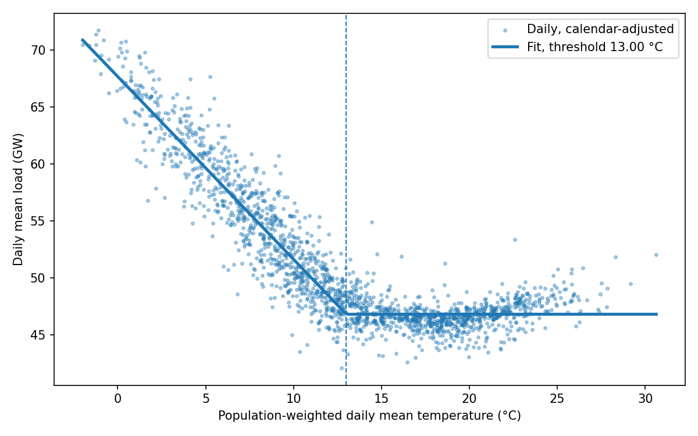
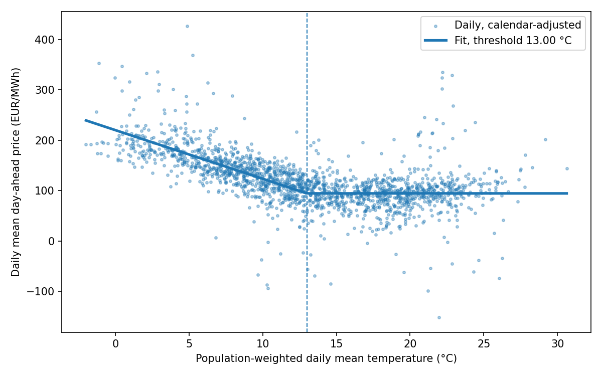

# Thermosensitivity of French demand and prices

The project began as this study; the day-ahead price forecast (see [forecast.md](forecast.md)) grew out of it. Moved from the README on 2026-10-15, unchanged.

How much does French electricity demand rise when it gets colder, and what does that do to the day-ahead price?

France heats a large share of its homes with electricity, so its demand is unusually sensitive to temperature. RTE usually puts the winter figure at roughly 2,400 MW for each degree colder. This project estimates that number from public data, along with the matching day-ahead price effect, and checks the model out of sample.

## What it does

1. Downloads hourly French actual load and day-ahead prices from one of several pluggable sources (see [data.md](data.md#data-sources)), and hourly temperatures for eight French cities from the Open-Meteo archive.
2. Builds a population-weighted national temperature and averages everything into local calendar days.
3. Fits a piecewise-linear model. Above a threshold temperature, weather barely moves demand. Below it, each degree colder adds a fixed amount of load. The threshold is chosen by grid search.
4. Fits the same shape to the day-ahead price, using the load model's threshold.
5. Trains on all but the last 12 months and forecasts the last 12 months of load to check the model out of sample.
6. Writes a summary and two charts to `reports/`.

## Results

Run on 2021-01-01 to 2025-12-31 (1,826 days) with RTE load, ENTSO-E day-ahead prices and Open-Meteo temperatures. All numbers below are copied from `reports/summary.json` and `reports/yearly.csv` as produced by `thermo-fr fit`.

- Heating threshold: 13.00 °C
- Load: +1,605 MW per degree colder below the threshold (s.e. 22), R² 0.962
- Price: +9.67 EUR/MWh per degree colder (s.e. 0.45), R² 0.874; excluding 2022: +6.58 (s.e. 0.30)
- Out of sample, last 365 days trained to 2024-12-31: MAE 1,593 MW, MAPE 3.12%

Year by year, with the threshold held at 13.00 °C:

| Year | Load MW per °C (s.e.) | Price EUR/MWh per °C (s.e.) | Price R² | Mean price EUR/MWh | Price gradient, % of mean |
|---|---|---|---|---|---|
| 2021 | 1,649 (50) | 6.92 (0.74) | 0.863 | 109.2 | 6.33 |
| 2022 | 1,763 (50) | 22.40 (1.69) | 0.754 | 275.9 | 8.12 |
| 2023 | 1,694 (48) | 8.27 (0.53) | 0.714 | 96.9 | 8.54 |
| 2024 | 1,456 (53) | 4.62 (0.56) | 0.647 | 58.0 | 7.96 |
| 2025 | 1,469 (46) | 6.30 (0.50) | 0.722 | 61.1 | 10.31 |

Load sensitivity has fallen: the 2024 and 2025 estimates are about 14% below the 2021 to 2023 average, in line with the demand reductions that followed the 2022 energy crisis. The price effect in EUR/MWh moves with the price level, 22.4 in 2022 against 4.6 to 8.3 in the other years, but as a share of each year's mean price it stays within 6 to 10%. A cold day therefore raises the day-ahead price by a fairly constant fraction, whatever gas costs that year.





## Setup

```bash
python -m venv .venv
source .venv/bin/activate          # Windows: .venv\Scripts\activate
pip install -e ".[dev]"            # add ",forecast" inside the brackets for the price forecast (LightGBM, scikit-learn)
```

Open-Meteo, Energy-Charts and RTE need no key. Only the `entsoe` source does.

## Usage

```bash
thermo-fr demo                                      # offline, synthetic data with known answers
thermo-fr fetch --start 2021-01-01 --end 2026-01-01 # real data, saved to data/hourly.csv
thermo-fr fit                                       # results in reports/
pytest                                              # run the tests, all offline
```

`fetch` takes `--load-source` and `--price-source`, each one of `rte`, `energy-charts`, `entsoe` or `csv`. The defaults are `rte` for load and `energy-charts` for prices, which need no key:

```bash
thermo-fr fetch --start 2021-01-01 --end 2026-01-01 --load-source rte --price-source energy-charts
thermo-fr fetch --start 2021-01-01 --end 2026-01-01 --load-source csv --price-source csv --csv-dir data/csv
```

Next to `data/hourly.csv`, `fetch` writes `sources.json` (which source produced which series, with licence attribution and the dataset details) and `quality.json`. A short quality summary is printed: the share of missing hours per series, negative load, load outside 20,000 to 100,000 MW, and prices outside -500 to 4,000 EUR/MWh. Gaps are reported, never filled. `fit` copies the source information into `summary.json` and `summary.md`.

## Design choices

- **UTC everywhere, local time only for grouping into days.** The spring daylight-saving day has 23 hours and the autumn one has 25. Converting to Paris time only at the grouping step keeps both days intact, and the tests check this for every source.
- **Sub-hourly data is averaged to hourly.** The day-ahead market moved to 15-minute products in 2025, so prices and load are resampled to hourly means before anything else.
- **Fixed effects for each calendar month.** The slope is learned from day-to-day weather swings within a month, not from the gap between summer and winter. This stops changes in gas prices, demand trends or policy from leaking into the temperature estimate.
- **Population weighting.** Paris carries more weight than Strasbourg because that is where the heating load is. The weights are approximate metropolitan populations.
- **Weekday and public-holiday controls.** French holidays come from the `holidays` package.
- **Sources are interchangeable.** Every source implements the same two methods, `load(start, end)` and `day_ahead_prices(start, end)`, returning hourly tz-aware UTC series named `load_mw` and `price_eur_mwh`. A source that lacks a series says so instead of guessing.

## Limitations

- Standard errors are conditional on the chosen threshold, so they understate the true uncertainty a little.
- The model is daily. Hourly shape, especially the evening peak, would need a separate model.
- The price effect mixes the demand response with anything else that tends to happen on cold days (low wind, plant outages). Adding nuclear availability and renewable output would separate them.
- The out-of-sample check uses actual temperatures, so it measures the model, not the weather forecast.
- RTE's consolidated data omits the repeated hour on the autumn daylight-saving day, so that day has 24 of its 25 hours. It is kept, since the daily table only requires 22.
